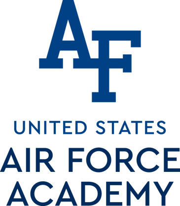

<!-- .slide: class="title-slide" -->

# ECE 444

Antennas, Phased Arrays, and Radar Systems

## Lesson 38 — Radar Open Lab

Fall 2026 · Dr. Neil Rogers

---

## Learning outcomes

By the end of this lesson, you will be able to:

- I can integrate FMCW radar processing with a phased-array front-end to track a moving target.

Note:
Shell deck — outline to be filled in.

---

## Outline

1. _Coming soon._

Note:
Placeholder. Build the lecture flow here.
